<div align="center">


# MyDoctor — Telemedicine Android App

**Find a doctor, pick a slot and book a consultation, all from your phone.**

A two-sided healthcare app where **patients** discover doctors and book appointments,
and **doctors** manage their availability, holidays and incoming appointments.


</div>

---

## 📸 Screenshots

<div align="center">

### 🔐 Onboarding

| Splash | Login (Email) | Login (Phone OTP) |
|:---:|:---:|:---:|
| 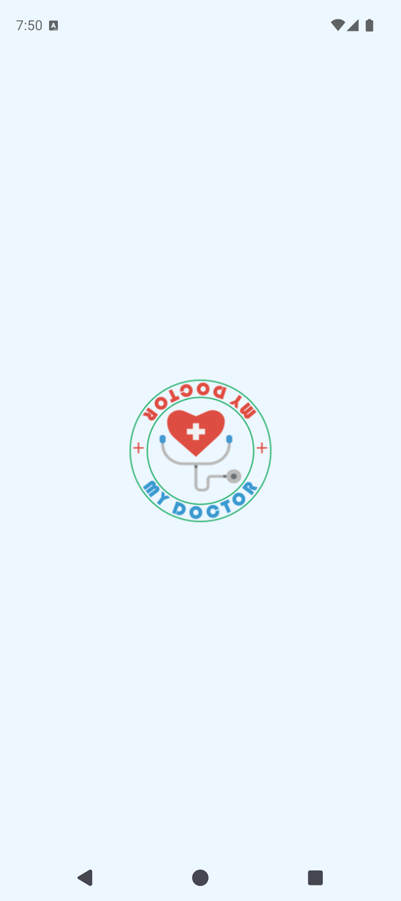 | 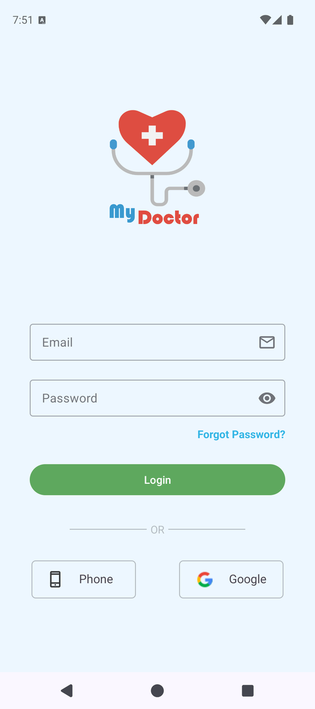 | 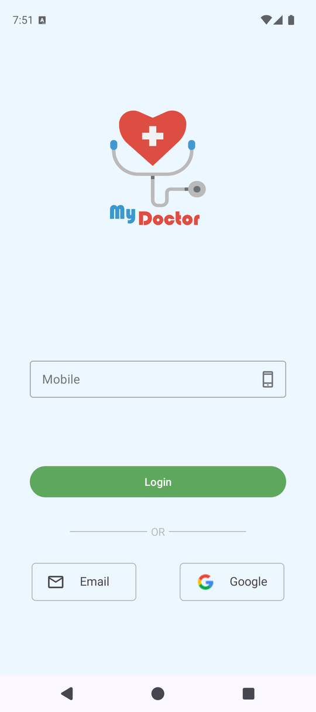 |

### 👤 Patient: find a doctor

| Home | Doctor Profile & Reviews | My Profile |
|:---:|:---:|:---:|
| 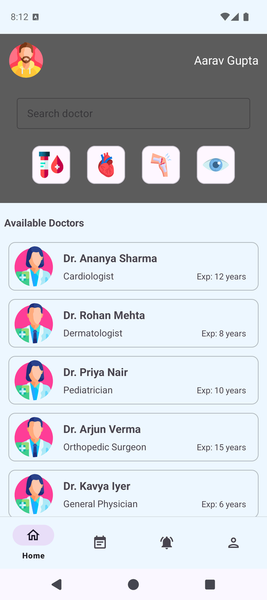 | 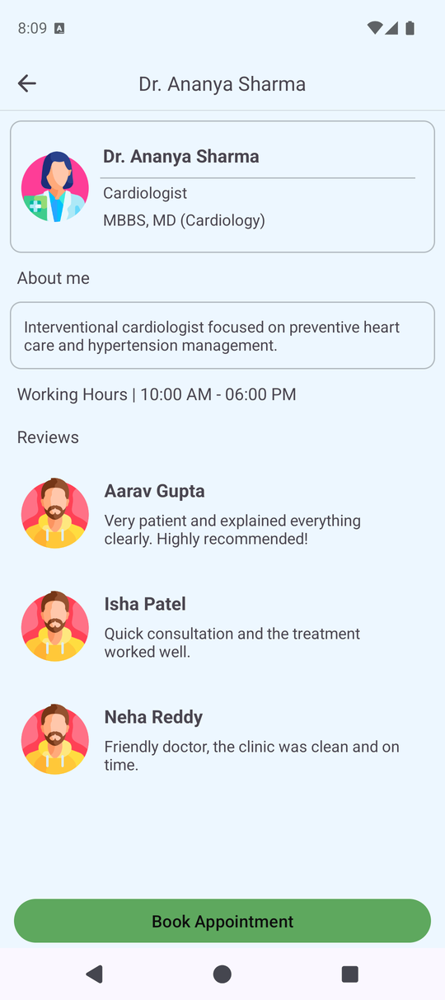 | 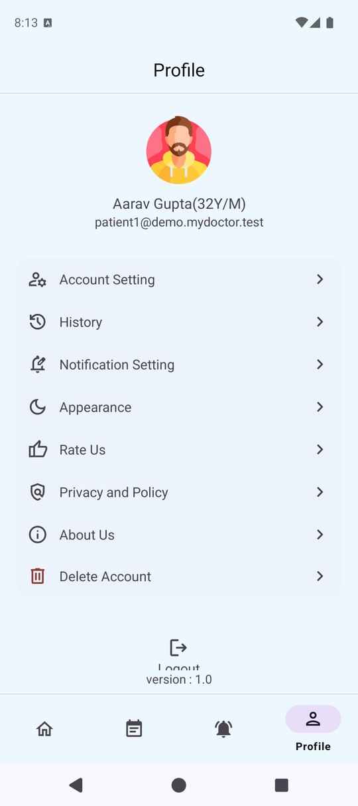 |

### 📅 Patient: booking flow

| 1. Date & Slot | 2. Patient Details | 3. Consultation Mode | 4. Summary |
|:---:|:---:|:---:|:---:|
| 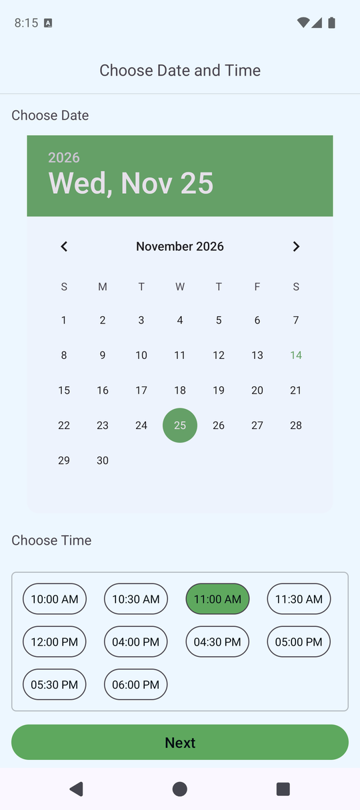 | 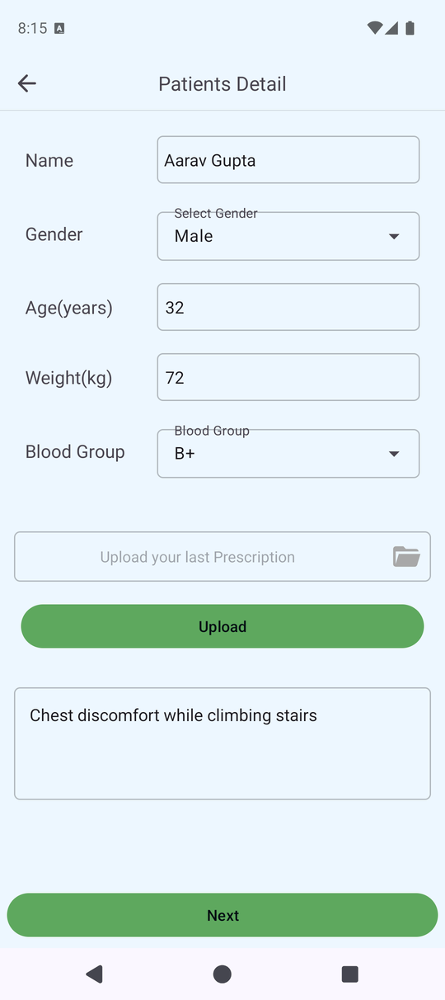 | 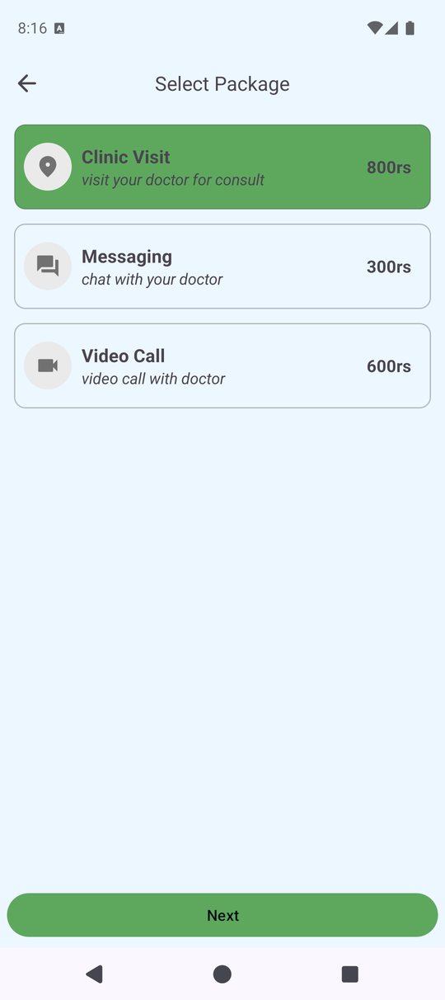 | 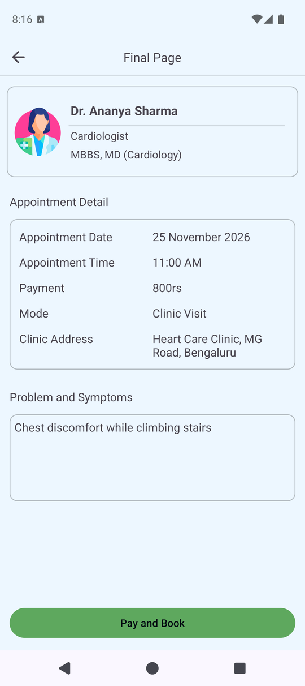 |

| 5. Payment | 6. Confirmed | Appointment Details | Upcoming / Completed |
|:---:|:---:|:---:|:---:|
| 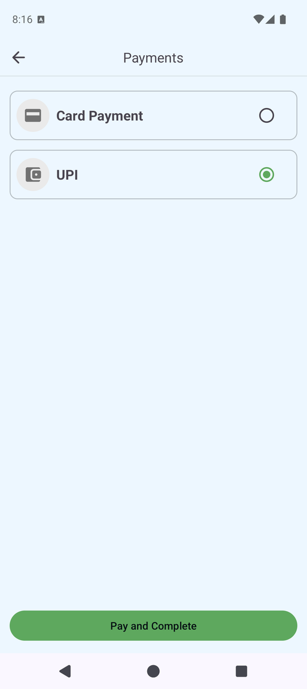 | 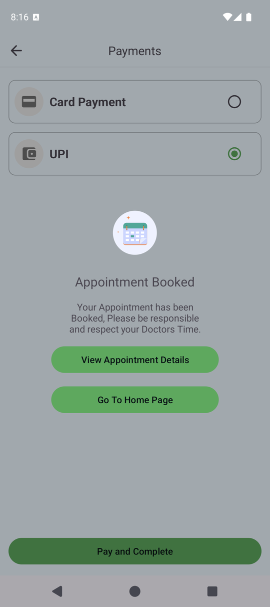 | 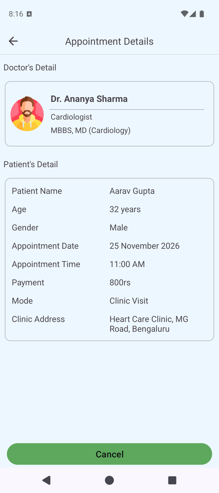 | 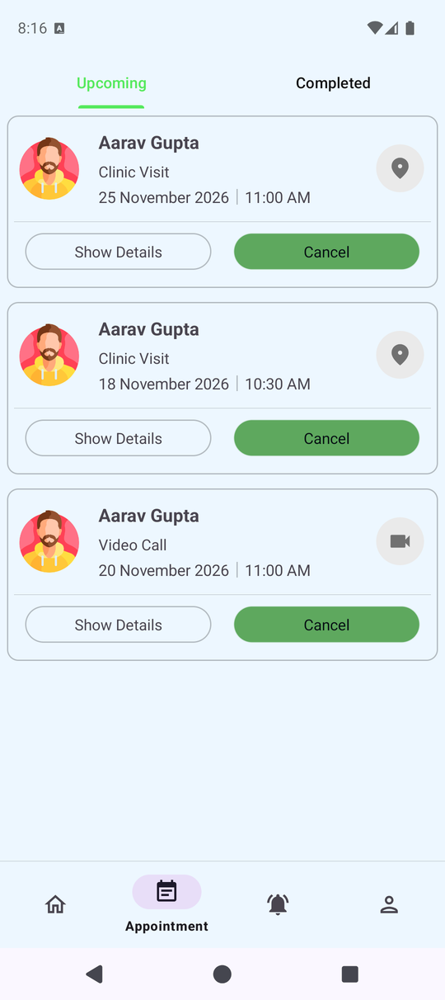 |

### 🩺 Doctor

| Dashboard | Upcoming | Completed | Account | Holidays |
|:---:|:---:|:---:|:---:|:---:|
| 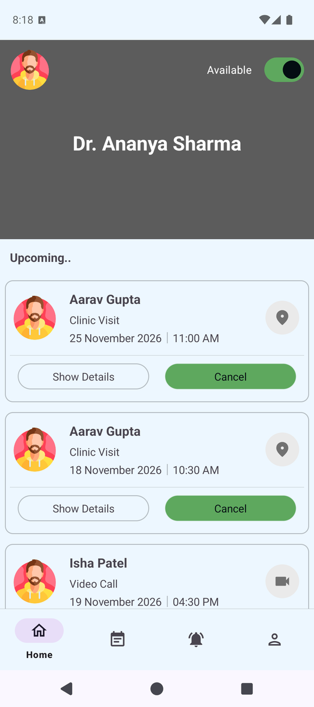 | 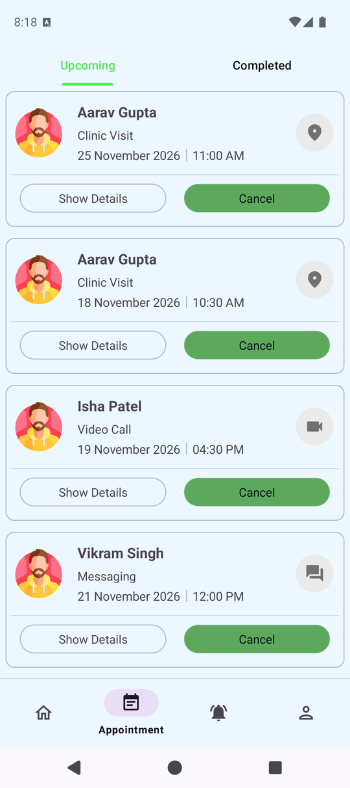 | 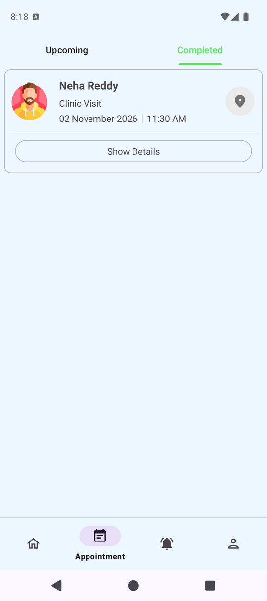 | 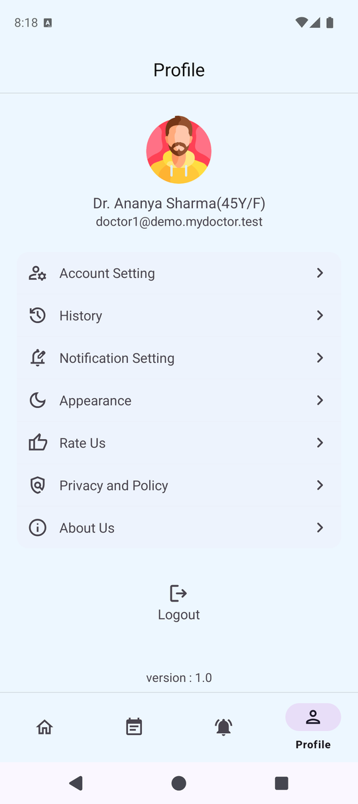 | 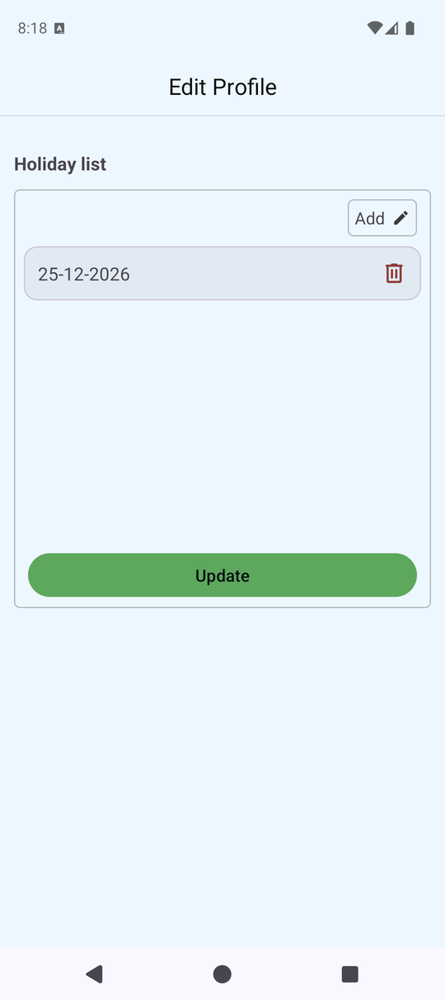 |

</div>

> Screenshots use **demo data** from the local Firebase Emulator (see [Run with demo data](#-run-with-demo-data-firebase-emulator)). No real users are shown.

---

## ✨ Features

### 👤 For Patients
- **Browse & search doctors** by name, with speciality, experience and profile photo
- **Doctor profile**: qualification, about, working hours and reviews
- **Step-by-step booking flow**
  1. Choose a date and an available time slot (doctor holidays are blocked automatically)
  2. Enter patient details: name, age, gender, weight, blood group and symptoms
  3. Upload a previous prescription or report (image)
  4. Pick a consultation mode: **Clinic Visit · Messaging · Voice Call · Video Call**, each with its own fee
  5. Review the summary and confirm
- **My Appointments**: *Upcoming* and *Completed* tabs, with details and cancel option
- **Profile management**: edit profile, change photo, delete account

### 🩺 For Doctors
- **Multi-step onboarding**: basic info → professional details (registration no., qualification, speciality, experience) → availability (working days, per-day time slots, consultation modes & fees) → terms
- **Dashboard** with upcoming appointments and an availability switch
- **Holiday management**: mark dates as leave so patients can't book them

### 🔐 Authentication
- Email & password (with password reset)
- Phone number with **OTP verification**
- **Google Sign-In**
- Role-based routing: users are sent to the Patient or Doctor experience automatically

---

## 🛠 Tech Stack

| Layer | Technology |
|---|---|
| Language | Java 8 |
| UI | XML layouts, Material Components, ViewBinding, Lottie animations |
| Navigation | Jetpack Navigation Component + Safe Args, Bottom Navigation, ViewPager2 |
| Architecture | MVVM: `ViewModel` + `LiveData` |
| Local cache | Room (offline copy of the logged-in user's profile) |
| Backend | Firebase Authentication, Realtime Database, Cloud Storage |
| Images | Glide, CircleImageView |
| Responsive sizing | SDP / SSP |

---

## 🏗 Project Structure

```
app/src/main/java/com/racks/mydoctor/
├── activities/   # Screens: Main (router), Login, SignUp, Patient, Doctor, Booking, Details, Edit Profile
├── fragments/    # Login/OTP, 4-step SignUp, Home, Profile, Appointments, Booking steps, Payment
├── adapters/     # RecyclerView adapters (doctors, appointments, reviews) & ViewPager adapter
├── models/       # Data models, ViewModels, Room DAO
└── helper/       # Auth, image upload/compression, Room DB, SharedPreferences, network utils
```

### App flow

```
MainActivity (splash + router)
 ├── not logged in ─────────▶ LoginActivity ──▶ SignUpActivity (new users)
 ├── userType = Patient ────▶ PatientActivity  (Home · Appointments · Profile)
 │                              └─▶ DoctorDetail ─▶ BookAppointment
 │                                   (Date & Slot → Patient Details → Mode → Summary → Payment)
 └── userType = Doctor ─────▶ DoctorActivity   (Dashboard · Appointments · Profile)
```

### Firebase Realtime Database structure

```
├── Users
│   ├── Doctors/{uid}      # profile, consultationModesAndCharges, {day}Slots, holidays, Reviews
│   └── Patients/{uid}     # profile
├── Appointments/{id}      # doctorId, patientId, date, time, mode, charge, isCompleted, ...
└── terms_and_conditions   # { Doctor: "...", Patient: "..." }
```

---

## 🚀 Getting Started

### Prerequisites
- Android Studio (latest stable)
- JDK 17+
- A Firebase project

### 1. Clone
```bash
git clone https://github.com/racks1401/telemedicine-android-app.git
```

### 2. Connect Firebase
1. Create an Android app in the [Firebase Console](https://console.firebase.google.com/) with package name `com.racks.mydoctor`.
2. Download **`google-services.json`** and place it in the `app/` folder *(it's git-ignored on purpose)*.
3. Enable **Authentication** providers: Email/Password, Phone and Google.
4. Add your debug **SHA-1** fingerprint (needed for Google Sign-In and Phone OTP).
5. Create a **Realtime Database** and a **Cloud Storage** bucket.
6. Add an index for appointment queries in Realtime Database rules:
   ```json
   "Appointments": { ".indexOn": ["doctorId", "patientId"] }
   ```

### 3. Signing config
The build reads signing keys from `local.properties` (git-ignored). Add:
```properties
MYAPP_UPLOAD_STORE_FILE=path/to/your.jks
MYAPP_UPLOAD_STORE_PASSWORD=****
MYAPP_UPLOAD_KEY_ALIAS=****
MYAPP_UPLOAD_KEY_PASSWORD=****
```

### 4. Build & run
```bash
./gradlew assembleDebug
```
Or press **Run ▶** in Android Studio.

---

## 🧪 Run with demo data (Firebase Emulator)

Try the full app **without touching your real Firebase project**. The [`firebase-emulator/`](firebase-emulator) folder runs Auth, Realtime Database and Storage locally and seeds **5 demo doctors, 5 demo patients and 8 appointments**.

```bash
# 1. Start the local emulators (needs Firebase CLI + Java 11+)
cd firebase-emulator
firebase emulators:start --only auth,database,storage --project <your-firebase-project-id>

# 2. In another terminal, load the demo data
python firebase-emulator/seed.py

# 3. Build & install a debug app that talks to the emulators
./gradlew installDebug -PuseFirebaseEmulator=true
```

Log in with `doctor1@demo.mydoctor.test` … `doctor5@…` or `patient1@demo.mydoctor.test` … `patient5@…`. The password is `DEMO_PASSWORD` in [`seed.py`](firebase-emulator/seed.py). These accounts exist **only** inside the local emulator.

> Without `-PuseFirebaseEmulator=true`, debug and release builds use the real Firebase project as usual. Emulator UI: http://127.0.0.1:4000

---

## 🗺 Roadmap

- [ ] Real payment gateway integration (currently the payment step only records the booking)
- [ ] In-app chat, voice and video consultation
- [ ] Push notifications for booking confirmation and reminders
- [ ] Patients can write doctor reviews and ratings
- [ ] Doctors can mark appointments completed and attach prescriptions

---

## 👨‍💻 Author

**Ravi Kumar Prabudh**: [@racks1401](https://github.com/racks1401)

<div align="center">

If you found this project useful, consider giving it a ⭐

</div>
